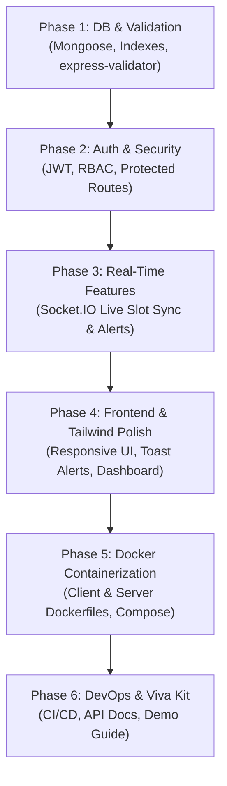

# Project Roadmap: GymHub (College Evaluation)

This roadmap organizes the development into 6 manageable execution phases, guaranteeing that all 9 checklist criteria are complete and demonstrable for the evaluation committee.

---

## Phase Overview

---

## Detailed Phases

### Phase 1: Database Architecture & Input Validation
- **Goal:** Harden MongoDB models, add integrity constraints, and introduce a validation layer.
- **Checklist Covered:** *MongoDB & Mongoose*, *Data Validation*, *Backend REST API*.
- **Key Deliverables:**
  - Add compound unique index on `Booking` (`{ user: 1, gymClass: 1 }`).
  - Add `bookedCount` / remaining calculation to `GymClass` model.
  - Install and configure `express-validator` middleware for auth, class creation, and booking requests.
  - Standardize API error responses with descriptive validation error messages.

### Phase 2: Authentication, Authorization & Route Protection
- **Goal:** Robust JWT authentication, role guards, and client-side protection.
- **Checklist Covered:** *Authentication & Authorization*, *React & State Management*.
- **Key Deliverables:**
  - Verify password hashing and JWT payload security (expiration handling).
  - Create client-side `ProtectedRoute.jsx` and `AdminRoute.jsx` components.
  - Redirect unauthenticated or unauthorized users with helpful notification banners.
  - Implement seamless logout with state cleanup.

### Phase 3: Real-Time Engine with Socket.IO
- **Goal:** Connect client and server via WebSockets for live class capacity updates and notifications.
- **Checklist Covered:** *Real-Time Features (Socket.IO)*, *React & State Management*.
- **Key Deliverables:**
  - Create a clean `socket.js` service / `useSocket` hook in React.
  - Emit `class_capacity_changed` when a user books or cancels a spot.
  - Dynamically update remaining seats on `Classes.jsx` and `ClassCard.jsx` without page refresh.
  - Emit real-time notification popups when classes are filled or modified.

### Phase 4: Frontend UI/UX Refinement with Tailwind CSS
- **Goal:** Elevate visual aesthetics, mobile responsiveness, and feedback mechanisms.
- **Checklist Covered:** *Frontend with Tailwind*, *React & State Management*.
- **Key Deliverables:**
  - Integrate a lightweight toast notification system (e.g. `react-hot-toast` or custom Tailwind toast).
  - Ensure 100% mobile responsiveness (hamburger menu on mobile navbar, card grid adjustments).
  - Add confirmation modals for class deletion and booking cancellation.
  - Polish Admin Dashboard with live stats (total members, total bookings, active classes).

### Phase 5: Docker Containerization
- **Goal:** Complete containerization of frontend, backend, and database for zero-friction setup.
- **Checklist Covered:** *Docker*.
- **Key Deliverables:**
  - `server/Dockerfile`: Node alpine runtime, optimized layer caching, non-root user.
  - `client/Dockerfile`: Multi-stage build (build with Vite, serve with lightweight Nginx or static server).
  - `docker-compose.yml`: Services for `client`, `server`, and `mongo` with volume persistence and healthchecks.
  - Verify local startup with `docker compose up --build`.

### Phase 6: DevOps, CI/CD & Viva Presentation Kit
- **Goal:** Automated checks, environment configs, and college evaluation presentation artifacts.
- **Checklist Covered:** *DevOps & Deployment*, *Evaluation Readiness*.
- **Key Deliverables:**
  - `.github/workflows/ci.yml`: GitHub Actions pipeline for linting and build checks.
  - `.env.example` files for both server and client.
  - `docs/API_DOCUMENTATION.md` detailing all endpoints with sample request/responses.
  - `docs/VIVA_PRESENTATION_GUIDE.md`: Step-by-step viva script, architectural diagram, and talking points for each of the 9 checklist criteria.

