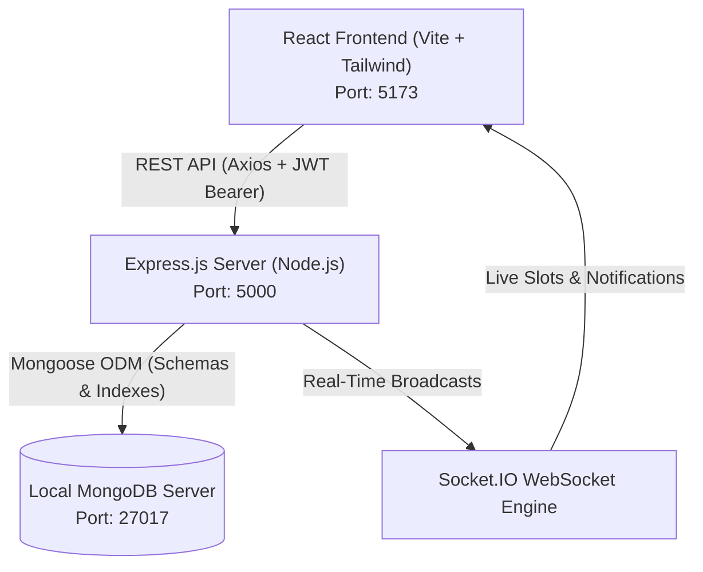

# ⚡ GymHub — Gym Management System (MERN Stack)

> **College Mini Project Evaluation Submission**  
> A full-stack MERN (MongoDB, Express.js, React, Node.js) web application featuring real-time WebSocket notifications, JWT role-based access control, strict server-side data validation, and Docker containerization.

---

## 📋 Evaluation Checklist Compliance

All 9 mandatory criteria from the college evaluation checklist have been fully implemented and verified:

| # | Evaluation Checklist Item | Implementation Details in GymHub | Status |
|---|---|---|:---:|
| 1 | **Frontend with Tailwind** | Modern, responsive UI designed with Tailwind CSS v4 (`@tailwindcss/vite`), custom capacity bars, and interactive modals. | ✅ **Complete** |
| 2 | **React & State Management** | React 19 + Vite 8, React Router DOM v7, Context API (`AuthContext`), custom hooks (`useAuth`), and live Socket.IO state listeners. | ✅ **Complete** |
| 3 | **Backend REST API** | Express 5 modular MVC architecture, standardized status codes, computed available spots, and cascade deletions. | ✅ **Complete** |
| 4 | **MongoDB & Mongoose** | Local MongoDB on port 27017, Mongoose schemas, compound unique index `{ user: 1, gymClass: 1 }`, and automated seed script. | ✅ **Complete** |
| 5 | **Data Validation** | Server-side `express-validator` middleware chains on Auth, Classes, and Bookings with structured HTTP 400 error responses. | ✅ **Complete** |
| 6 | **Authentication & Authorization** | JWT generation with `{ id, role }`, bcryptjs password hashing, `protect` & `admin` RBAC middleware, and `<ProtectedRoute>`. | ✅ **Complete** |
| 7 | **Real-Time Features (Socket.IO)** | Bi-directional WebSockets, live slot decrement/increment across tabs, and live `NotificationBell` with unread badge counter. | ✅ **Complete** |
| 8 | **Docker** | Multi-container setup (`docker-compose.yml`) linking client (Nginx multi-stage build), server (Node Alpine), and MongoDB. | ✅ **Complete** |
| 9 | **DevOps & Deployment** | GitHub Actions CI workflow (`.github/workflows/ci.yml`), Postman Collection (`GymHub_Postman_Collection.json`), and Viva guide. | ✅ **Complete** |

---

## 🏗️ System Architecture



---

## 🚀 Quick Start Guide (Local Development)

### Prerequisites
- [Node.js (v18+)](https://nodejs.org/)
- [Local MongoDB](https://www.mongodb.com/try/download/community) running on port `27017`

### 1. Clone & Setup
```bash
git clone <your-repo-url>
cd "gym project for caollage"
```

### 2. Configure Environment (`server/.env`)
```env
PORT=5000
MONGO_URI=mongodb://127.0.0.1:27017/gym-management
JWT_SECRET=gym_secret_key_2026
JWT_EXPIRES_IN=30d
```

### 3. Seed Database with Demo Accounts
```bash
cd server
npm install
node seed.js
```

### 4. Start Development Servers
**Terminal 1 (Backend):**
```bash
cd server
npm run dev
# Server runs at http://localhost:5000
```

**Terminal 2 (Frontend):**
```bash
cd client
npm install
npm run dev
# App runs at http://localhost:5173
```

---

## 🐳 Docker Deployment (One-Command Startup)

Run the entire stack (React + Nginx, Express API, MongoDB container) with a single command:
```bash
docker compose up --build
```
- Frontend: `http://localhost:5173`
- Backend API: `http://localhost:5000`
- MongoDB: `localhost:27017`

---

## 🔑 Demo Credentials

| Role | Email | Password | Access Level |
|---|---|---|---|
| **Member User** | `john@example.com` | `password123` | Browse classes, book spots, view/cancel in "My Bookings" |
| **Admin User** | `admin@gymhub.com` | `password123` | Full admin dashboard (`/admin`), create/delete classes, view all member bookings |

---

## 📡 REST API Endpoints Overview

| Method | Endpoint | Access | Description |
|---|---|---|---|
| `POST` | `/api/auth/register` | Public | Register new member user (`express-validator` protected) |
| `POST` | `/api/auth/login` | Public | Login and receive signed JWT token |
| `GET` | `/api/auth/profile` | Private | Fetch logged-in user details (`protect` middleware) |
| `GET` | `/api/classes` | Public | Fetch classes with computed `bookedCount` & `availableSlots` |
| `GET` | `/api/classes/:id` | Public | Fetch single class details |
| `POST` | `/api/classes` | Admin | Create class (broadcasts `class_created` via Socket.IO) |
| `PUT` | `/api/classes/:id` | Admin | Update class details (broadcasts `class_updated`) |
| `DELETE` | `/api/classes/:id` | Admin | Delete class & cascade-delete bookings (broadcasts `class_deleted`) |
| `POST` | `/api/bookings` | Private | Book class (enforces compound unique index, broadcasts slot sync) |
| `GET` | `/api/bookings/my` | Private | Fetch current user's active bookings |
| `GET` | `/api/bookings` | Admin | View all bookings across the entire gym |
| `DELETE` | `/api/bookings/:id` | Private/Admin | Cancel booking & increment available spots live |

---

## 🎓 Faculty Demonstration & Viva Guide

For the exact two-tab screen sharing script, walkthrough steps, and answers to faculty questions (*"Have you applied JWT?"*, *"Are you doing data validation?"*, *"Have you deployed it?"*), refer to:
👉 **[docs/MINI_PROJECT_VIVA_WALKTHROUGH.md](docs/MINI_PROJECT_VIVA_WALKTHROUGH.md)**

To import all endpoints into Postman for live testing:
👉 **[GymHub_Postman_Collection.json](GymHub_Postman_Collection.json)**

